# 🫧 Bubble Shooter

<div align="center">


**A complete Bubble Shooter — 50 levels, pure logic, no assets.**

*Match 3+ · Combos · Power-ups · Obstacles · 3-star scoring · Save system*

[🚀 Setup](#-setup--run--build) • [🎮 Controls](#-controls) • [📜 Rules](#-rules) • [🏗️ Architecture](#-architecture) • [➕ Add a Level](#-add-a-level)

</div>

---

## 📖 Overview

**Bubble Shooter** is a **complete** bubble shooter game built with **TypeScript + Phaser 3 + Vite**.

### Core Idea

> **The rules are separate from the rendering.**
>
> `GameSession` owns score, combo, misses, and win/lose. `GameScene` calls `fire()` / `land()` and animates the returned `TurnResult`. **The same code runs in the bot that plays all 50 levels and in the tests.**

### What's Included

- **50 JSON levels**
- Power-ups
- Obstacles
- Combos
- 3-star scoring
- Save system
- **Procedural audio and art** — no asset downloads

---

## 🚀 Setup / Run / Build

```bash
npm install
npm run dev       # http://localhost:5173
npm run build     # type-checks, then bundles to dist/
npm run preview   # serve the production build
```

### 📜 Other Scripts

| Script | What It Does |
|--------|--------------|
| **`npm test`** | Headless checks of the core rules — hex grid, matching, floating, specials, obstacles, validation |
| **`npm run simulate`** | A bot plays all 50 levels with the real rules and prints win rates *(**`-- --write`** re-calibrates target scores)* |
| **`npm run levels`** | Regenerates the 50 level JSON files from `tools/generate-levels.mjs` *(then run **`npm run simulate -- --write`**)* |
| **`npm run typecheck`** | `tsc --noEmit` |

---

## 🎮 Controls

### 🖱️ Mouse

- **Move** to aim
- **Click** to shoot

### 📱 Touch

- **Press and drag** to aim
- **Release** to shoot
- **Drag below the launcher** to cancel

### ⌨️ Keyboard

| Input | Action |
|-------|--------|
| **Arrow keys** | Aim |
| **Space** | Shoot |
| **Esc** | Pause |

**Tap the NEXT bubble to swap.**

### 🛠️ Dev Builds Only

| Key | Action |
|:---:|--------|
| **`N`** | Next level |
| **`R`** | Restart |
| **`W`** | Win |
| **`G`** | Grid debug |
| **`P`** | Pause |

**Add `?debug` to the URL for the FPS/state overlay.**

> ✅ **All of this is disabled in `npm run build` output.**

---

## 📜 Rules

<div align="center">

| Mechanic | Details |
|----------|---------|
| **🎯 Core match** | Match **3+ of a color** — bubbles cut off from the ceiling **fall** |
| **🔢 Shot limit** | Each level has a limited number of **`moves`** |
| **🏆 Win condition** | Reach the level's **`targetScore`** — or clear the board |
| **⭐ Stars** | Based on **shots left** — **≥50% = 3 stars**, **≥25% = 2 stars** |
| **❌ Miss meter** | Every **miss** *(a shot that pops nothing)* fills the miss meter — when full, **a new row drops in** |
| **💀 Lose condition** | Bubbles reaching the **red line** end the game |
| **🔥 Combos** | Consecutive popping shots build **`COMBO xN`** with bonus points — **a miss resets it** |

</div>

### 🧱 Obstacles

| Obstacle | How to Clear |
|----------|-------------|
| **🪨 Stone** | Only **specials** or **falling** remove it |
| **❄️ Ice** | **2 adjacent pops** |
| **🔒 Locked** | **1 adjacent pop** |
| **⛓️ Chain** | **3 shots landing next to it** |

### ⚡ Specials *(Rare, with a Pity Timer)*

| Special | Effect |
|---------|--------|
| **💣 Bomb** | Clears **1 ring** |
| **🔥 Fire** | Clears **2 rings** |
| **⚡ Lightning** | Clears a **row** — or **column** for steep shots |
| **🌈 Rainbow** | Becomes the **best-matching color** |
| **❄️ Freeze** | **Misses do not count** for **3 shots** |

---

## 🏗️ Architecture

### System Overview

```mermaid
flowchart TB
    subgraph CONFIG["⚙️ Config"]
        GameConfig["GameConfig<br/>all constants"]
        BubbleConfig["BubbleConfig<br/>colors · obstacles · power-ups"]
        LevelConfig["LevelConfig"]
        AssetConfig["AssetConfig"]
        DebugConfig["DebugConfig"]
    end

    subgraph PURE["🧠 Pure Logic — No Phaser"]
        Grid["BubbleGrid<br/><em>hex, 11/10 rows</em>"]
        Collision["CollisionSystem<br/>shot tracer"]
        Match["MatchSystem"]
        Floating["FloatingBubbleSystem"]
        Power["PowerUpSystem"]
        Resolver["ShotResolver"]
        Score["ScoreManager<br/><em>the only place scoring lives</em>"]
        Combo["ComboSystem"]
        Ammo["BubbleShooter<br/>ammo queue"]
        Session["GameSession<br/><em>a whole run</em>"]
        Validator["LevelValidator"]
        State["GameState<br/>state machine"]
    end

    subgraph PHASER["🎮 Phaser-Facing"]
        Bubble["Bubble"]
        GridView["GridView"]
        Aim["AimSystem"]
        LevelMgr["LevelManager"]
    end

    subgraph ENTITIES["🎯 Entities"]
        Player["Player<br/>launcher"]
        Projectile["Projectile"]
    end

    subgraph SYSTEMS["⚙️ Systems"]
        Audio["AudioManager<br/>WebAudio synth"]
        Save["SaveManager<br/>localStorage + memory fallback"]
        Particles["ParticleManager<br/>pooled"]
        Anim["AnimationManager"]
        Input["InputManager"]
        Texture["TextureFactory<br/>all art, canvas-generated"]
    end

    subgraph UI["🖥️ UI"]
        HUD["HUD"]
        Button["Button"]
        Progress["ProgressBar"]
        Dialog["Dialog"]
        LevelCard["LevelCard"]
        Background["Background"]
        Debug["DebugOverlay"]
    end

    subgraph SCENES["🎬 Scenes"]
        Boot["Boot"]
        Preload["Preload"]
        MainMenu["MainMenu"]
        LevelSelect["LevelSelect"]
        Game["Game"]
        Pause["Pause"]
        Complete["LevelComplete"]
        Over["GameOver"]
        Settings["Settings"]
    end

    CONFIG --> PURE
    PURE --> PHASER
    PHASER --> ENTITIES
    ENTITIES --> SYSTEMS
    SYSTEMS --> UI
    UI --> SCENES

    style CONFIG fill:#61DAFB,color:#000
    style PURE fill:#8B5CF6,color:#fff
    style PHASER fill:#22C55E,color:#fff
    style ENTITIES fill:#FFB454,color:#000
    style SYSTEMS fill:#FF6B6B,color:#fff
    style UI fill:#0f3460,color:#fff
    style SCENES fill:#000,color:#fff
```



### 📂 Project Layout

```
bubble-shooter/
├── src/
│   ├── config/       GameConfig · BubbleConfig · LevelConfig
│   │                 AssetConfig · DebugConfig
│   │
│   ├── types/        GameTypes · LevelTypes
│   │
│   ├── game/         PURE logic — no Phaser
│   │                 BubbleGrid · CollisionSystem · MatchSystem
│   │                 FloatingBubbleSystem · PowerUpSystem
│   │                 ShotResolver · ScoreManager · ComboSystem
│   │                 BubbleShooter (ammo) · GameSession
│   │                 LevelValidator · GameState
│   │
│   │                 Phaser-facing
│   │                 Bubble · GridView · AimSystem · LevelManager
│   │
│   ├── entities/     Player (launcher) · Projectile
│   │
│   ├── systems/      AudioManager · SaveManager · ParticleManager
│   │                 AnimationManager · InputManager · TextureFactory
│   │
│   ├── ui/           HUD · Button · ProgressBar · Dialog
│   │                 LevelCard · Background · DebugOverlay · TextStyles
│   │
│   ├── scenes/       Boot · Preload · MainMenu · LevelSelect
│   │                 Game · Pause · LevelComplete · GameOver · Settings
│   │
│   └── data/         GameData (bundles levels/*.json)
│                     levels/level01..50.json
│
├── tools/
│   ├── generate-levels.mjs
│   └── simulate.mjs
│
└── public/
    └── assets/       optional real assets
```

### 🎯 Key Ideas

<div align="center">

| Idea | Implementation |
|------|---------------|
| **🧠 Rules separate from rendering** | `GameSession` owns score, combo, misses, win/lose. `GameScene` calls `fire()` / `land()` and animates the returned `TurnResult`. **The same code runs in the bot and the tests** |
| **🎯 What you see is what happens** | The aim preview and the real shot use the **same tracer** *(`traceShot`)*. The projectile just **animates along the pre-computed path** |
| **🔷 Hex grid with stable parity** | Rows alternate between **11 and 10** cells. `BubbleGrid.parity` flips when a row is inserted at the top so **existing bubbles never move sideways** |
| **💯 Scoring is centralized** | Scoring lives **only** in `ScoreManager`, tuned by the tables in `GameConfig` |
| **🛡️ Resilience by default** | Invalid colors/tokens/layouts are **sanitized with console warnings**. An unusable level is **replaced by a fallback**. Missing audio, localStorage, or assets **degrade gracefully** |

</div>

---

## ➕ Add a Level

**Drop `level51.json` into `src/data/levels/`.**

> ✅ **No code changes — it is bundled and appears on the map automatically.**

```json
{
  "id": 51,
  "name": "My Level",
  "moves": 24,
  "targetScore": 3000,
  "missLimit": 5,
  "colors": ["red", "blue", "green"],
  "specials": { "types": ["bomb", "rainbow"], "chance": 0.08 },
  "layout": [
    ["red", "red", "blue", "blue", "green", "green", "red", "red", "blue", "blue", "green"],
    ["blue", "stone", "ice:red", "locked:green", "chain:blue", ".", "red", "red", "blue", "blue"]
  ]
}
```

### 📐 Layout Rules

- **Row 0** has up to **11** cells
- **Row 1** has up to **10** cells
- **Rows alternate**
- **Tokens:**
  - A color name — e.g. `"red"`
  - `"."` — empty
  - `"stone"` — stone obstacle
  - `"ice:"` / `"locked:"` / `"chain:"` + color — combined obstacle
- **`specials`** is optional

> 💡 **Run `npm run simulate`** to see how a bot fares and tune `targetScore`.

---

## 🎨 Add a Bubble Color, Obstacle, or Power-Up

<div align="center">

| What to Add | Steps |
|-------------|-------|
| **🎨 Color** | Add an entry to **`BUBBLE_COLORS`** in `config/BubbleConfig.ts` — **textures are generated automatically**; use its id in level files |
| **🧱 Obstacle** | 1. Add its kind to **`ObstacleKind`** *(in `types/GameTypes.ts`)*<br/>2. Add an **`OBSTACLES`** entry *(hp + trigger: `pop`, `impact`, `none`)*<br/>3. Add its **token** in `LevelValidator.parseToken`<br/>4. Add a **texture** in `TextureFactory` |
| **⚡ Power-up** | 1. Add the id to **`SpecialKind`**<br/>2. Add an entry in **`POWERUPS`** *(kind: `area` / `line` / `wild` / `status`, plus `rings` and `weight`)*<br/>3. Add an **`sp_<id>` texture** in `TextureFactory.specialBubble`<br/>4. **Area and line power-ups work from config alone** — a new behavior goes in `ShotResolver.resolveShot`<br/>5. List it in a level's **`specials.types`** |

</div>

---

## 🎨 Assets

> **None are required. Everything is generated at startup.**

**To override with real files:**

- See **`public/assets/README.md`**
- See **`src/config/AssetConfig.ts`**

---

## 🗺️ Roadmap

### ✅ Current

- [x] TypeScript + Phaser 3 + Vite setup
- [x] 50 JSON levels with validation and graceful fallback
- [x] Hex grid with 11/10 row alternation and stable parity
- [x] Match-3+ detection with floating bubble resolution
- [x] Shot tracer used by both aim preview and real shot
- [x] Ammo queue with bubble swap
- [x] Miss meter that drops a new row when full
- [x] Combo system with bonus points
- [x] 3-star scoring based on shots left
- [x] 4 obstacle types — stone, ice, locked, chain
- [x] 5 special power-ups with pity timer — bomb, fire, lightning, rainbow, freeze
- [x] Save system with localStorage and memory fallback
- [x] Procedural audio via WebAudio synth
- [x] Procedural art via `TextureFactory`
- [x] Pooled particle system
- [x] Full scene flow — Boot, Preload, MainMenu, LevelSelect, Game, Pause, LevelComplete, GameOver, Settings
- [x] HUD, buttons, progress bars, dialogs, level cards, background
- [x] Dev-only debug keys and `?debug` overlay
- [x] Headless rule tests via `npm test`
- [x] Bot simulation across all 50 levels with win rates
- [x] Level generator tool
- [x] Type-checked builds via `npm run typecheck`
- [x] Debug tooling disabled in production builds

### 🔜 Future Ideas

- [ ] **More levels** beyond the current 50
- [ ] **Additional power-ups** — new behaviors in `ShotResolver`
- [ ] **Endless mode**
- [ ] **Daily challenge** with fixed seeds
- [ ] **Local leaderboards** per level
- [ ] **Real art pipeline** — sprite sheets and animations
- [ ] **Music tracks** — layered ambient beds
- [ ] **Accessibility options** — colorblind palettes, larger bubbles
- [ ] **Boss levels** — a new obstacle pattern with unique mechanics
- [ ] **Mobile-specific UI polish**

---

## 🤝 Contributing

Contributions are welcome. Please:

1. Fork the repository
2. **Keep the rules pure** — `GameSession` and its dependencies must not import Phaser
3. **Keep the shot tracer shared** — the preview and the real shot must use the same code
4. **Preserve hex parity stability** — existing bubbles must never move sideways
5. **Centralize scoring** — scoring lives only in `ScoreManager`
6. **Validate and sanitize level data** — bad data must warn, not crash
7. **Keep dev-only features out of production builds**
8. Submit a Pull Request

### Guidelines

- **Never bypass `GameSession`** — the whole game must be testable headlessly
- **Never duplicate the shot tracer** — one tracer, one source of truth
- **Never add a required external asset** — procedural art and audio are the fallback
- **Never break the level JSON format** without a migration path
- **Never let a bad level take down the whole game** — the fallback exists for a reason

---

## 📜 License

MIT — see [LICENSE](LICENSE) for details.

---

## 🙏 Acknowledgments

- **Phaser 3** — for a framework that stays out of the way of pure logic
- **Vite** — for dev speed that makes iteration pleasant
- **TypeScript** — for making the rules safe to refactor
- **Every bubble shooter that ever made you see hexagons in your sleep** — this one's for you

---

<div align="center">

### 🫧 AIM. MATCH. COMBO. CLEAR.

**50 levels. Pure rules. Zero assets.**

**The bot plays them all — and so can you.**

<br>

⭐ If you enjoyed this game, consider giving it a star.

<br>

[⬆ Back to Top](#-bubble-shooter)

</div>
